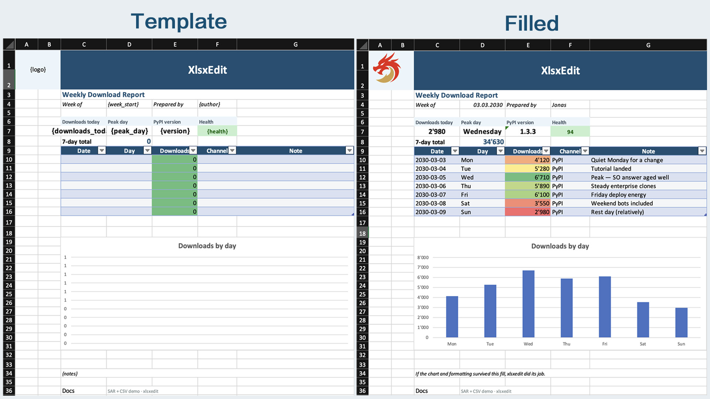

# xlsxedit

> **This is an independent fork** of [jonas-kupferschmid/xlsxedit](https://github.com/jonas-kupferschmid/xlsxedit), the library Jonas Ruilong Kupferschmid created. It is maintained separately by Cat Grandi and is not affiliated with the upstream project. Its releases are only on [this repository's Releases page](https://github.com/catgrandi/xlsxedit/releases); `pip install xlsxedit` installs the upstream package from PyPI instead. Report problems with this fork in [its issues](https://github.com/catgrandi/xlsxedit/issues), not upstream. [CHANGELOG.md](CHANGELOG.md) lists what it changes.

Edit Excel files from Python **without breaking layout**, **formatting**, or **file compatibility**.

Loads the `.xlsx` as an OPC package and **surgically** patches XML with lxml — **only what you change gets rewritten**.



**Upstream project:** [jonas-kupferschmid/xlsxedit](https://github.com/jonas-kupferschmid/xlsxedit); its website, [xlsxedit.jonasruilong.com](https://xlsxedit.jonasruilong.com), documents the upstream releases.

## The problem

Styled `.xlsx` files saved through typical Python Excel libraries often come back broken — repair dialogs, shifted layout, lost formatting.

These libraries **rebuild** the workbook from an object model. Anything they do not fully implement — styles, merges, images, charts, other OOXML — is **dropped on save**.

**xlsxedit** keeps the file as an OPC package, patches only the XML you change, and writes it back — layout, formatting, and the rest of the design survive.

## Why xlsxedit

- **Fill templates** — `Workbook.open("invoice.xlsx")`, typed `replace("{date}", …, value_type="date")`, save; merges, themes, and conditional formatting stay put
- **Search & replace** — text placeholders across sheets; swap pictures with `replace_image` or `{logo}` → `insert_image_at_placeholder`
- **Export into a designed layout** — `write_dataframe` drops rows into a report slot with `row_styles` / `column_styles` (no rebuild-from-scratch)
- **Template fidelity** — charts, drawings, tables, and unknown OOXML round-trip when you do not touch them
- **Headless** — no Excel app; runs on servers, CI, and cron jobs
- **Familiar API** — `Workbook.open` → mutate → `save`
- **Also:** fast direct file I/O, optional pandas `engine="xlsxedit"` for `read_excel` / `ExcelWriter`

## Features

**Workbook** — `open`, `create`, `save`, `sheetnames`, `add_worksheet`, `rename_worksheet`, `remove_worksheet`, `properties` (title, author, created, …), `orphan_partnames`; opens `.xlsm` / `.xltx` too (VBA round-trips untouched)

**Cells** — typed `value` (str, int, float, bool, `date`, `datetime`), `formula`, `clear`, `find` / `findall`, `offset`, `iter_cells`, `iter_rows`

**Styles** — `cell.style` read (bold, colors, fonts, alignment, number format), `apply_style`, `apply_date_format`, `apply_number_format`

**Layout** — `column_dimensions`, `row_dimensions`, `merge_cells`, `unmerge_cells`, `clear_range`, `write_rows`, `insert_rows`, `insert_columns`

**Links** — `cell.hyperlink.url`, `cell.hyperlink.location`, `cell.hyperlink.display`

**Images** — `add_image`, `images`, `Picture.replace`, `replace_image`, `insert_image_at_placeholder`

**Charts** — `add_chart`, `charts`, `to_anchor`, `offset_x`/`offset_y` (post-create), read/set `title`, `set_series_formula`

**Tables** — `add_table`, `tables`, `Table.resize`, and each table's columns, header and totals rows, style and ranges

**Conditional formatting** — read blocks and rules; `add_conditional_formatting` (`cellIs`); `add_color_scale_formatting`

**Data validation** — `data_validations`, `add_data_validation` (dropdown lists, number, date, text-length and custom rules), `remove_data_validation`

**Search & replace** — workbook/sheet `replace` (substring or whole-cell with `value_type`: text, number, date)

**Bulk export** — `write_dataframe`, `write_rows`, `insert_rows`, `row_styles`, `column_styles`; `Workbook.open(..., large=True)` for big files

**Fidelity** — round-trip tested on real fixtures: images, charts, tables, conditional formatting, merges, hyperlinks, custom sizes

**[Full feature reference →](docs/features.md)**

## Compared to other libraries

| | **xlsxedit** | **openpyxl** | **xlsxwriter** | **xlwings** |
|--|--------------|--------------|----------------|-------------|
| Open existing file | Yes (direct file) | Yes | No | Yes (launches Excel) |
| Template fidelity | Designed for preservation | Often loses styles/charts/unknown XML | N/A (create only) | Depends on Excel |
| Headless / server / CI | Yes | Yes | Yes | **No** |
| Typical speed | Fast direct I/O | Moderate | Fast (create) | **Slow** (Excel startup + COM) |
| Excel app required | No | No | No | **Yes** |

[Full comparison →](docs/why-xlsxedit.md)

## Install

Install a release of this fork from GitHub, replacing `<tag>` with a tag from the [Releases page](https://github.com/catgrandi/xlsxedit/releases):

```bash
pip install "xlsxedit @ git+https://github.com/catgrandi/xlsxedit@<tag>"
pip install "xlsxedit[pandas] @ git+https://github.com/catgrandi/xlsxedit@<tag>"   # with the optional ExcelWriter / read_excel engine
```

Each release also carries the built wheel and sdist, which `pip install` takes as a file or URL. `pip install xlsxedit` installs the upstream package from PyPI, not this fork.

**AI coding agents** — the skill for agents that use this library is [`.agents/skills/xlsxedit/`](.agents/skills/xlsxedit/SKILL.md); copy that folder into your agent's skills folder.

Development:

```bash
pip install -e ".[dev]"
```

## Quick start — fill a template

```python
from xlsxedit import Workbook

wb = Workbook("invoice-template.xlsx")  # same as Workbook.open(...)
wb.replace("{client}", "Jonas Corp")
wb.replace("{amount}", 520, value_type="number")
wb.replace("{date}", "2025-08-07", value_type="date")
wb.save("invoice-filled.xlsx")
```

## API showcase

```python
from datetime import datetime
from xlsxedit import Workbook

wb = Workbook()  # new blank workbook; same as Workbook.create()
ws = wb["Sheet1"] # get worksheet by name

# set cell values
ws["A1"].value = "hello" # set cell value
ws["A2"].value = 42 # set cell value
ws["A3"].value = datetime(2025, 8, 7) # set cell value
ws["A3"].apply_date_format() # apply date format
ws["B2"].formula = "=A2*2" # set cell formula

# set column width and row height of worksheet
ws.column_dimensions["C"].width = 20.0
ws.row_dimensions[4].height = 30.0
ws.merge_cells("A1:C1") # merge cells

# insert_rows: insert one row at row 10 — writes A10="New line", B10=100; existing row 10+ shifts down
ws.insert_rows([["New line", 100]], at_cell="A10")

# insert_columns: insert one column at C — values top→bottom from C2; existing C+ move right
# (the A1:C1 merge straddles the new column, so it grows to A1:D1)
ws.insert_columns([("Note", "detail")], at_cell="C2")

# write_rows: write at fixed rows without shifting (overwrites cells in that range)
ws.write_rows([["Total", 520]], at_cell="A20")

# add hyperlink
ws["E1"].value = "Docs"
ws["E1"].hyperlink.url = "https://xlsxedit.jonasruilong.com"

ws.add_image("logo.jpg", anchor="E2", width=180, height=135)
ws.add_chart("bar", anchor="G2", data_range="A1:B5", title="Sales")
# optional to_anchor (default: anchor + 6 cols × 13 rows, e.g. C19 → I32):
# ws.add_chart("bar", anchor="C19", to_anchor="H32", data_range="A1:B5")
# the header row must hold the column names; write_header=True writes them
ws.add_table("F10:G15", ["Item", "Qty"], name="Items", write_header=True)
ws.add_conditional_formatting("A2:A20", operator="greaterThan", formula="0")

report = wb.add_worksheet("Report")
wb.rename_worksheet("Report", "Summary")

wb.replace("PLACEHOLDER", "Jonas Corp")
wb.replace("{qty}", 888, value_type="number")
wb.save("out.xlsx")
```

See [`tutorial/run_tutorial.py`](https://github.com/jonas-kupferschmid/xlsxedit/blob/main/tutorial/run_tutorial.py) for a full walkthrough.

## Bulk export (many rows)

```python
wb = Workbook("report-template.xlsx")  # same as Workbook.open(...)
wb.write_dataframe(
    df,
    at_cell="A5",
    header=False,
    mode="overwrite",
    row_styles=[{"bg_color": "FFFFFFFF"}, {"bg_color": "FF9DC3E6"}],
)
wb.save("report.xlsx")
```

Tutorials: [`tutorial/pandas_tutorial.py`](https://github.com/jonas-kupferschmid/xlsxedit/blob/main/tutorial/pandas_tutorial.py) (pandas engine), [`tutorial/run_tutorial.py`](https://github.com/jonas-kupferschmid/xlsxedit/blob/main/tutorial/run_tutorial.py), [`tutorial/export_pandas_example.py`](https://github.com/jonas-kupferschmid/xlsxedit/blob/main/tutorial/export_pandas_example.py) (advanced bulk), [`tutorial/bench_large_export.py`](https://github.com/jonas-kupferschmid/xlsxedit/blob/main/tutorial/bench_large_export.py)

## Pandas quick start

```python
import pandas as pd
import xlsxedit.pandas_io as xpi

xpi.register()  # once per process

df = pd.DataFrame({"Item": ["Widget", "Gadget"], "Qty": [2, 5]})

with pd.ExcelWriter("out.xlsx", engine="xlsxedit") as writer:
    df.to_excel(writer, sheet_name="Data", index=False)

got = pd.read_excel("out.xlsx", engine="xlsxedit")
```

Opt-in engine today (`register()`); a future pandas PR may add official reader registration. Full docs: [Pandas engine](docs/pandas.md). Tutorial: [`tutorial/pandas_tutorial.py`](tutorial/pandas_tutorial.py).

## When to use / when not

**Use xlsxedit when:**

- Filling styled Excel templates from Python
- You need charts, images, or layout to survive after edits
- Running headless on a server or in CI without Excel installed

**Use something else when:**

- You need live Excel recalc, VBA, or UI automation → **xlwings**
- You only create new workbooks from scratch → **xlsxwriter**
- You need pivot editing or every openpyxl feature today → **openpyxl** (xlsxedit API is still growing)

**Missing something?** [Open an issue on this fork](https://github.com/catgrandi/xlsxedit/issues). Please don't report this fork's behaviour to the upstream project.

## Credits

xlsxedit was created by [Jonas Ruilong Kupferschmid](https://github.com/jonas-kupferschmid), who maintains the upstream project. This fork is maintained by Cat Grandi; [CHANGELOG.md](CHANGELOG.md) lists what it adds. To support the original author, see his [sponsorship page](https://xlsxedit.jonasruilong.com/sponsor).

## Acknowledgments

xlsxedit owes a lot to [Steve Canny (scanny)](https://github.com/scanny) and [python-docx](https://github.com/python-docx/python-docx). I loved his idea of editing Word documents surgically — patch the package, leave the design intact — and wanted the same thing for Excel. (When I started to use python-docx, I researched it extensively to understand how it works) That inspiration is why xlsxedit exists.

The OPC package layer (`src/xlsxedit/opc/**` and `src/xlsxedit/oxml/parser.py`) is adapted from python-docx and [python-pptx](https://github.com/python-pptx/python-pptx) (MIT licensed, Copyright (c) 2013 Steve Canny). That notice is in [`NOTICE`](NOTICE) and [`THIRD_PARTY_LICENSES`](THIRD_PARTY_LICENSES). xlsxedit is independent and not affiliated with those projects — but thank you, Steve, for the foundation.

## License

xlsxedit is licensed under the [Apache License 2.0](LICENSE). Portions adapted from python-docx / python-pptx remain under their original MIT license; see [`NOTICE`](NOTICE) and [`THIRD_PARTY_LICENSES`](THIRD_PARTY_LICENSES). Contributions to the upstream project are accepted under its [Contributor License Agreement](https://github.com/jonas-kupferschmid/xlsxedit/blob/main/CLA.md). For how contributions to this fork are handled, see [`CONTRIBUTING.md`](CONTRIBUTING.md).

## Example projects

Small companion repos by the upstream author, written against the upstream releases:

- **[xlsx-sar-test](https://github.com/jonas-kupferschmid/xlsx-sar-test)** — **Weekly Download Report** hero demo: `build_template.py` builds a styled template (logo, table, chart, CF); `run_demo.py` fills header/KPI placeholders from `sar.yaml` and bulk-inserts the daily table from CSV — chart and layout survive. SAR-only: `apply_sar.py`
- **[xlsx-inspect](https://github.com/jonas-kupferschmid/xlsx-inspect)** — unpack `.xlsx` files into pretty-printed XML folders and pack them back; useful to see what is inside a workbook on disk

## Documentation

- [Features](docs/features.md)
- [Why xlsxedit?](docs/why-xlsxedit.md)
- [How it works](docs/how-xlsxedit-works.md)
- [Large data export](docs/large-data-export.md)
- [Pandas engine](docs/pandas.md)
- [Excel `.xlsx` structure](docs/excel-xlsx-structure.md)
